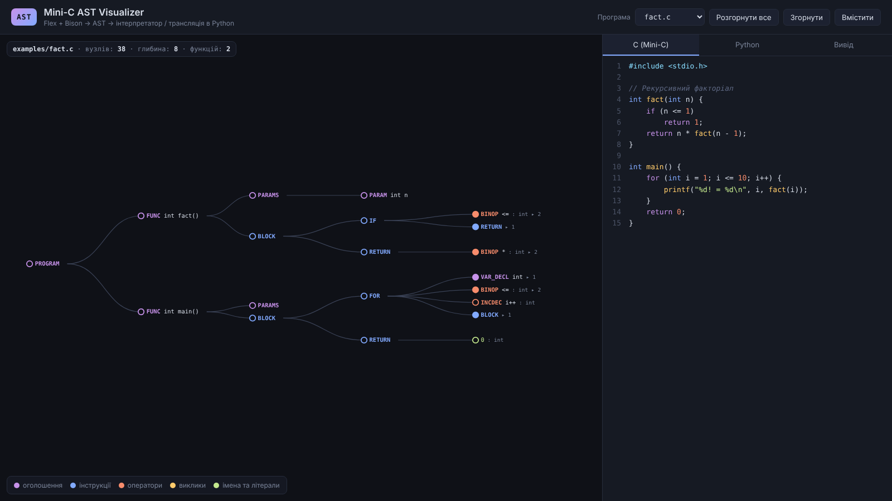
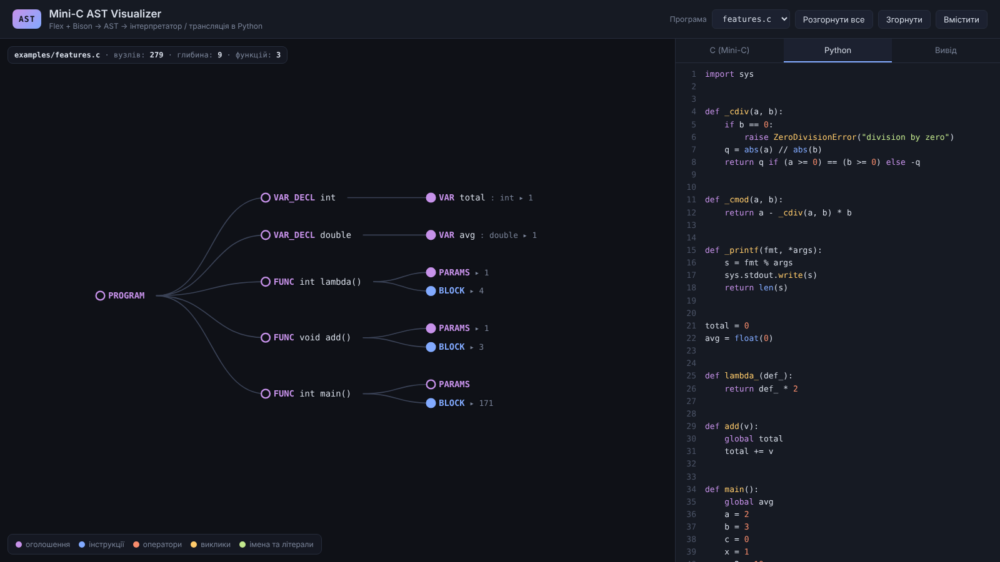

# Лабораторна робота №3. Синтаксичний аналізатор на Flex/Bison

Дисципліна: Системне програмування
Виконала: Острєцова К.В., група ТК-31

## Завдання

На базі Lex/YACC розробити синтаксичний аналізатор для C або іншої імперативної мови.
Додатково: семантика (обчислення), генерація коду на цільовій мові, візуалізація AST.

## Що зроблено

Я обрала підмножину мови C, яку назвала Mini-C. Будь-яка програма на Mini-C є звичайною
програмою на C, тому її можна скомпілювати gcc і порівняти результати.

Mini-C підтримує:
- типи `int`, `double`, `void` (тільки для функцій);
- глобальні та локальні змінні, функції з параметрами, рекурсію;
- `if/else`, `while`, `for`, `break`, `continue`, `return`;
- оператори `+ - * / %`, порівняння, `&& || !`, `= += -= *= /= %=`, `++`, `--`;
- `printf` з форматами `%d`, `%f`, `%.2f` тощо;
- коментарі `//` та `/* */`, рядки `#include` пропускаються.

Опис мови і граматика в BNF: [docs/grammar.md](docs/grammar.md).

Що вміє програма `minic`:
1. лексичний аналіз (Flex) і синтаксичний аналіз (Bison, LALR(1)) з побудовою AST;
2. семантичний аналіз: таблиця символів, перевірка оголошень, кількості аргументів, типів;
3. виконання програми інтерпретатором (обхід AST);
4. трансляція програми в Python 3;
5. експорт AST у JSON і візуалізація дерева в браузері (d3.js).



## Як запустити

Я працювала в WSL (Ubuntu). Потрібні пакети:

```bash
sudo apt install -y build-essential flex bison python3
```

Збірка і тести:

```bash
make
make test
```

Візуалізація (після запуску відкрити http://localhost:8000):

```bash
make serve
```

Команди:

```bash
./minic parse examples/fact.c    # перевірка синтаксису
./minic trace examples/fact.c    # трасування роботи LALR-парсера
./minic ast   examples/fact.c    # вивести AST
./minic check examples/fact.c    # синтаксис + семантика
./minic run   examples/fact.c    # виконати програму
./minic py    examples/fact.c    # перекласти на Python
./minic json  examples/fact.c    # AST у JSON
```

Інші цілі Makefile: `make test-run`, `make test-py`, `make ast`, `make conflicts`,
`make web`, `make lexer_test`, `make clean`.

## Структура

```
src/lexer.l        лексер (Flex)
src/parser.y       граматика і побудова AST (Bison)
src/ast.c/.h       структура вузлів AST, друк дерева
src/semantic.c/.h  семантичний аналіз
src/interp.c/.h    інтерпретатор
src/codegen_py.c/.h генерація коду на Python
src/ast_json.c/.h  експорт у JSON
src/main.c         головна програма
src/lexer_test.c   окрема перевірка лексера
examples/          тестові програми
conflicts/         граматики з конфліктами для демонстрації
web/               візуалізація AST (d3.js)
docs/              граматика і скріншоти
```

## Опис роботи

### Лексер

У `lexer.l` для кожного токена записаний регулярний вираз. Ключові слова стоять раніше
за правило для ідентифікаторів, бо при однаковій довжині Flex бере перше правило.
Оператори `<=`, `++`, `+=` розпізнаються як один токен за правилом найдовшого збігу.
Значення токена передається парсеру через `yylval`, номер рядка через `yylloc`.
Для багаторядкових коментарів використовується стан `%x COMMENT`.

Перевірити лексер окремо можна так: `make lexer_test && ./lexer_test examples/fact.c`.

### Парсер

Граматика в `parser.y` має 77 правил, Bison будує для неї LALR-автомат на 140 станів
(файл `src/parser.output`).

Граматику виразів я записала неоднозначно (`expr : expr '+' expr`), а неоднозначність
прибрала пріоритетами і асоціативністю операторів (`%left`, `%right`, `%nonassoc`).
У `parser.output` видно, як Bison розв'язав ці конфлікти, наприклад:

```
Conflict between rule 61 and token '*' resolved as reduce ('*' < UMINUS).
Conflict between rule 30 and token "else" resolved as shift (LOWER_THAN_ELSE < "else").
```

Висячий else розв'язаний через `%prec LOWER_THAN_ELSE`, тобто else відноситься до
найближчого if. Директива `%expect 0` не дає зібрати проєкт, якщо в граматиці
з'явиться хоч один нерозв'язаний конфлікт.

У папці `conflicts/` є три маленькі граматики, на яких видно конфлікти:
- `1_expr_no_prec.y` - вирази без пріоритетів, 9 shift/reduce;
- `2_dangling_else.y` - висячий else, 1 shift/reduce;
- `3_reduce_reduce.y` - вираз `a * b;` (оголошення чи множення), 1 reduce/reduce.

Запуск: `make conflicts`, або детально з прикладами
`bison -Wcounterexamples conflicts/2_dangling_else.y`.

Команда `./minic trace` показує роботу парсера по кроках (shift, reduce, стек станів).

При синтаксичній помилці виводиться рядок і очікувані токени, а після помилки парсер
продовжує розбір з наступної `;` (правило `error ';'`).

### AST

AST будується в семантичних діях правил Bison. Приклад для `fact.c`:

```
PROGRAM   (line 4)
├── FUNC int fact   (line 4)
│   ├── PARAMS   (line 4)
│   │   └── PARAM int n   (line 4)
│   └── BLOCK   (line 4)
│       ├── IF   (line 5)
│       │   ├── BINOP <= : int   (line 5)
│       │   │   ├── ID n : int   (line 5)
│       │   │   └── INT_LIT 1 : int   (line 5)
...
```

### Семантичний аналіз

Обхід AST з таблицею символів, де області видимості вкладені одна в одну
(глобальна, функція, блок, for). Перевіряється, що змінні оголошені, немає повторних
оголошень, правильна кількість аргументів, `break`/`continue` тільки в циклі,
`return` відповідає типу функції, є `int main()`. Також для кожного виразу
визначається тип (`int` або `double`).

### Інтерпретатор

Інтерпретатор рекурсивно обходить AST. Вирази обчислює функція `eval`, інструкції
виконує `exec`. Для `break`, `continue`, `return` `exec` повертає відповідний статус.
Змінні зберігаються в середовищах, кожен блок створює нове.
Ціле ділення працює як у C (`-7 / 2 = -3`).

### Генерація коду на Python

Команда `./minic py` перекладає програму на Python 3. Найбільше часу пішло на місця,
де C і Python поводяться по-різному:

| C | Python | що зроблено |
|---|---|---|
| `-7 / 2` дорівнює -3 | `-7 // 2` дорівнює -4 | функції `_cdiv`, `_cmod` |
| `x++`, присвоєння у виразі | так не можна | оператор `:=` |
| цикл `for` | немає такого | `while`, крок дублюється перед `continue` |
| змінна в блоці `{ }` | області тільки у функцій | перейменування `x` -> `x_2` |
| зміна глобальної змінної | потрібно `global` | додається автоматично |
| `int x = 7.9` | тип не змінюється | `int(...)`, `float(...)` |

### Візуалізація

`make web` створює JSON для кожного прикладу, а сторінка `web/index.html` малює дерево
за допомогою d3.js (`d3.tree`). Вузли можна згортати кліком, дерево можна масштабувати.
При наведенні на вузол підсвічується рядок C-коду, а при кліку на рядок коду
підсвічуються його вузли. Окремо є вкладки з кодом на Python і виводом програми.



## Тестування

`make test` компілює кожен приклад gcc і порівнює вивід з виводом інтерпретатора
і згенерованої Python-програми:

```
interpreter vs gcc: 6 passed, 0 failed
python vs gcc: 6 passed, 0 failed
```

## Висновки

У роботі я розробила компілятор підмножини мови C за допомогою Flex і Bison.
Розібралась, як працює LALR(1)-аналізатор, як виникають shift/reduce і reduce/reduce
конфлікти і як їх розв'язувати пріоритетами. До AST додала семантичний аналіз,
інтерпретатор і трансляцію в Python, а також візуалізацію дерева в браузері.

Обмеження: немає масивів, вказівників, структур, `char`, `switch`, `do-while`.

## Література

1. Aho A. V., Ullman J. D. Principles of Compiler Design. Addison-Wesley, 1977.
2. IBM. Lex and yacc program information. https://www.ibm.com/docs/en/aix/7.2.0?topic=concepts-lex-yacc-program-information
3. GNU Bison Manual. https://www.gnu.org/software/bison/manual/
4. D3.js documentation. https://d3js.org/
